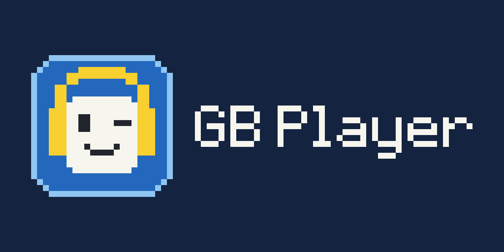
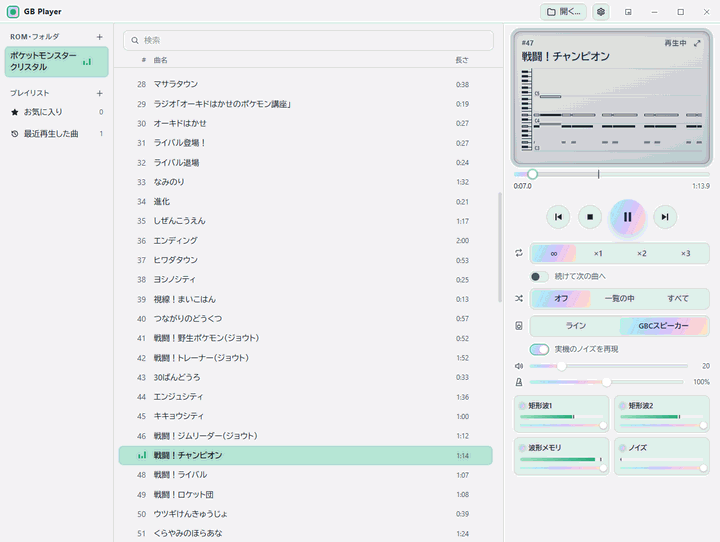
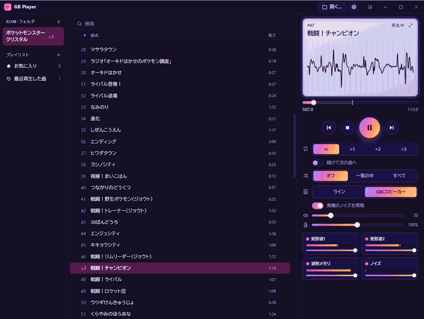
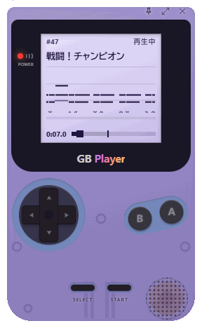
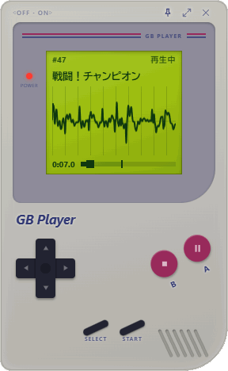

[English](README.md) | 日本語



# GB Player

[](https://github.com/SeeLog/gb-player/actions/workflows/rust.yml)
[](https://github.com/SeeLog/gb-player/actions/workflows/frontend.yml)
[](LICENSE)

ゲームボーイとゲームボーイカラーのROMに入っている曲を聴くプレイヤーです。ゲーム自身のサウンドエンジンを小さなエミュレータの上で動かして鳴らします。ROMを開いて曲を選べば、無限ループでも、決めた回数でフェードアウトでも聴けます。

| Prism テーマ、ピアノロール | Nebula テーマ、波形 |
| --- | --- |
|  |  |

| ミニプレイヤー、クリアパープル | ミニプレイヤー、クラシック風 |
| --- | --- |
|  |  |

- ゲームボーイ風のミニプレイヤー(ボタンで操作できます)
- ピアノロールと波形の表示、チャンネルごとのミュートとレベルメーター
- GBC実機のスピーカーを再現する音響エフェクト
- 音程を変えずにテンポを50%〜200%に変更
- WAV書き出し(チャンネル別にも)
- ROMをまたぐプレイリスト、お気に入り、履歴、シャッフル
- 背景画像も使える[テーマ](themes/README.ja.md)の編集
- GBSファイルと音声ファイル(MP3、FLACなど)の再生

## 仕組み

録音や変換した音楽データは使いません。ROMの中からサウンドエンジンを機械語のパターンで探し、ゲームと同じように1フレームごとに呼び出します。エンジンはエミュレートしたCPUの上で動いて、エミュレートした音源チップに書き込み、音源チップが再生しながら波形を作ります。ゲームの画面や進行は動かさず、音楽だけを鳴らします。

この出力をそのまま聴くことも、実機を録音して測ったGBCのスピーカーと本体のノイズを再現して聴くこともできます。

## 対応ソフト

| エンジン | ソフト |
| --- | --- |
| 第1世代 | ポケットモンスター 赤、緑、青、ピカチュウ(海外版の Red、Blue、Yellow も) |
| 第2世代 | ポケットモンスター 金、銀、クリスタル(海外版の Gold、Silver、Crystal も) |

そのまま動くのはこれらのソフトだけです。エンジンは機械語のパターンで探すので、言語やバージョンが違っても同じエンジンなら動くはずです。他のゲームは、サウンドドライバの関数のアドレスを自分で調べて `songs.toml` に書く必要があります([書き方](songdb/README.ja.md))。GBSファイルならその手間はいりませんが、曲名は出ません。

ROMとGBSファイルは付属しません。各自で用意してください。

## ダウンロード

最新版は[Releases](https://github.com/SeeLog/gb-player/releases/latest)からダウンロードできます。

| システム | ファイル |
| --- | --- |
| Windows(64ビット) | `gb-player-<version>-windows-x64-setup.exe`(インストーラ)か `gb-player-<version>-windows-x64.zip`(インストール不要) |
| macOS(Apple SiliconとIntel) | `gb-player-<version>-macos-universal.dmg` |

- **Windows:** 署名していないので、SmartScreenが「WindowsによってPCが保護されました」と表示することがあります。実行するには「詳細情報」を押してから「実行」を押してください。zip版には[WebView2 ランタイム](https://developer.microsoft.com/microsoft-edge/webview2/)が必要です。Windows 11には最初から入っています。
- **macOS:** `.dmg` を開いて、GB Playerをアプリケーションフォルダにドラッグしてください。
- **Linux:** 配布していないので、自分でビルドしてください。

動作はWindowsとmacOS 27(Apple Silicon)で確認しています。LinuxはCIでのビルドとテストのみです。

## ビルド

[Rust](https://rustup.rs/) と [bun](https://bun.sh/) が必要です。

```sh
bun install
bun run tauri build --no-bundle   # target/release/gb-player(.exe)
bun run tauri build               # Windowsならインストーラ、macOSなら.dmgも作る
bun run tauri dev                 # 開発用に起動
```

- **Windows:** MSVC版のツールチェーンを使ってください。GNU版は `dlltool.exe: program not found` で失敗します。
- **Linux:** `libasound2-dev libwebkit2gtk-4.1-dev libsoup-3.0-dev librsvg2-dev` を入れてください(Debian/Ubuntuの場合)。
- **macOS:** 追加のパッケージは要りません。

## 使い方

`gb-player` を起動して、ROMやGBSファイル、音楽フォルダをウィンドウにドロップします。コマンドラインからも使えます。

```sh
gb-player pokemon.gb                         # ROMを開く
gb-player --info pokemon.gb                  # 曲とループ長の一覧
gb-player --wav pokemon.gb 1 out.wav 2       # 1曲目を2ループ+フェードでWAVに
gb-player --wav pokemon.gb 1 out.wav 2 gbc-speaker stems   # スピーカーの音で、チャンネル別のファイルも
gb-player --lang ja pokemon.gb               # 言語を指定
```

| キー | 操作 |
| --- | --- |
| Space | 再生、一時停止 |
| ← → | 前の曲、次の曲 |
| Ctrl/Cmd+O / Ctrl/Cmd+F | ROMを開く / 検索 |
| Ctrl/Cmd+M | ミニプレイヤーに切り替え |
| Ctrl/Cmd+, | 設定 |
| F | ピアノロールと波形をウィンドウいっぱいに表示 |

メディアキーとヘッドセットのボタンは、ウィンドウが裏にあっても効きます。

設定、プレイリスト、テーマは `%APPDATA%\gb-player`(Linux と macOS は `~/.config/gb-player`)に保存します。

## 曲名

ROMに曲名は入っていないので、[`songdb/`](songdb/README.ja.md) から引いています。サウンドトラックに載っている曲は公式の曲名で、それ以外は場所や場面を説明する名前です。修正や他言語の追加はPRをください。

## 開発

```
crates/gb-core   エミュレーションコア(CPU、メモリマップ、MBC、APU)
crates/gb-music  ドライバ検出、曲リスト、再生、ループ解析
app              Tauri側、音声出力、CLI
ui               画面(React + TypeScript + Tailwind CSS)
songdb           曲データベース
```

テストは `cargo test --workspace` です。CPUを [SingleStepTests/sm83](https://github.com/SingleStepTests/sm83) でも確かめるときは、`SM83_TESTS_DIR` に `v1/` のフォルダを指定します。

## クレジット

- [pret](https://github.com/pret) の逆アセンブル(pokered、pokeyellow、pokegold、pokecrystal): エンジンの検出と曲データベースの元にしています
- [Pokémon Game Sound Library](https://soundlibrary.pokemon.co.jp/) と『ハートゴールド&ソウルシルバー』のサウンドトラック: 公式の曲名
- [SingleStepTests/sm83](https://github.com/SingleStepTests/sm83): CPUの検証
- [Tauri](https://tauri.app/)、[Symphonia](https://github.com/pdeljanov/Symphonia)、[cpal](https://github.com/RustAudio/cpal)、[React](https://react.dev/) などのライブラリ

## ライセンス

[MIT](LICENSE) です。

GB Player は非公式のツールで、任天堂、株式会社ポケモン、株式会社ゲームフリーク、株式会社クリーチャーズとは関係ありません。ROMやゲームの音楽は含みません。ポケモンとゲームボーイは各権利者の商標です。
