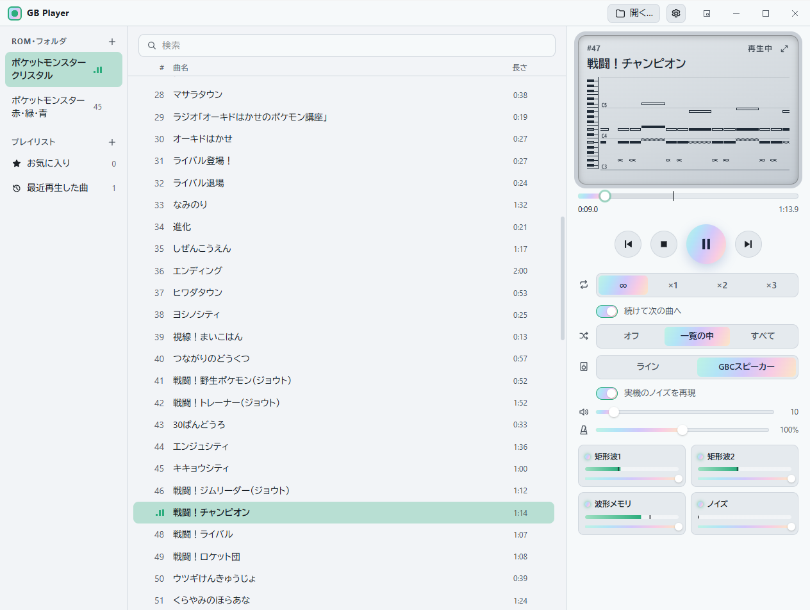
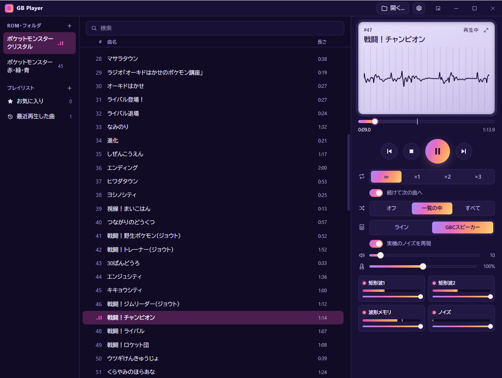
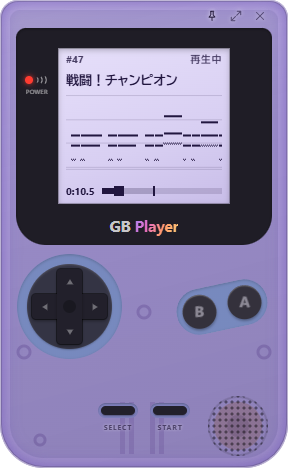
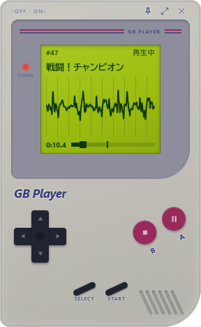

[English](README.md) | 日本語


# GB Player

ゲームボーイとゲームボーイカラーのROMに入っている曲を聴くプレイヤーです。ゲーム自身のサウンドエンジンを小さなエミュレータの上で動かして鳴らします。ROMを開いて曲を選べば、無限ループでも、決めた回数でフェードアウトでも聴けます。

| Prism テーマ、ピアノロール | Nebula テーマ、波形 |
| --- | --- |
|  |  |

| ミニプレイヤー、クリアパープル | ミニプレイヤー、初代型 |
| --- | --- |
|  |  |

- ゲームボーイやゲームボーイカラーの形をしたミニプレイヤー(ボタンで操作できます)
- ピアノロールと波形の表示、チャンネルごとのミュートとレベルメーター
- GBC実機のスピーカーを再現する音響エフェクト
- 音程を変えずにテンポを50%〜200%に変更
- WAV書き出し(チャンネル別にも)
- ROMをまたぐプレイリスト、お気に入り、履歴、シャッフル
- 背景画像も使える[テーマ](themes/README.ja.md)の編集
- GBSファイルと音声ファイル(MP3、FLACなど)の再生

## 対応ソフト

| エンジン | ソフト |
| --- | --- |
| 第1世代 | ポケットモンスター 赤、緑、青、ピカチュウ(海外版の Red、Blue、Yellow も) |
| 第2世代 | ポケットモンスター 金、銀、クリスタル(海外版の Gold、Silver、Crystal も) |

そのまま動くのはこれらのソフトだけです。エンジンは機械語のパターンで探すので、言語やバージョンが違っても同じエンジンなら動くはずです。他のゲームは、サウンドドライバの関数のアドレスを自分で調べて `songs.toml` に書く必要があります([書き方](songdb/README.md))。GBSファイルならその手間はいりませんが、曲名は出ません。

ROMとGBSファイルは付属しません。各自で用意してください。

## ビルド

配布用のバイナリはまだありません。[Rust](https://rustup.rs/) と [bun](https://bun.sh/) が必要です。

```sh
bun install
bun run tauri build --no-bundle   # target/release/gb-player(.exe)
bun run tauri build               # Windowsならインストーラも作る
bun run tauri dev                 # 開発用に起動
```

- **Windows:** MSVC版のツールチェーンを使ってください。GNU版は `dlltool.exe: program not found` で失敗します。
- **Linux:** `libasound2-dev libwebkit2gtk-4.1-dev libsoup-3.0-dev librsvg2-dev` を入れてください(Debian/Ubuntuの場合)。
- **macOS:** 追加のパッケージは要りません。

## 使い方

`gb-player` を起動して、ROMやGBSファイル、音楽フォルダをウィンドウにドロップします。コマンドラインからも使えます。

```sh
gb-player pokemon.gb                         # ROMを開く
gb-player --info pokemon.gb                  # 曲とループ長の一覧
gb-player --wav pokemon.gb 1 out.wav 2       # 1曲目を2ループ+フェードでWAVに
gb-player --wav pokemon.gb 1 out.wav 2 gbc-speaker stems   # スピーカーの音で、チャンネル別のファイルも
gb-player --lang ja pokemon.gb               # 言語を指定
```

| キー | 操作 |
| --- | --- |
| Space | 再生、一時停止 |
| ← → | 前の曲、次の曲 |
| Ctrl+O / Ctrl+F | ROMを開く / 検索 |
| Ctrl+M | ミニプレイヤーに切り替え |
| Ctrl+, | 設定 |
| F | ピアノロールと波形をウィンドウいっぱいに表示 |

メディアキーとヘッドセットのボタンは、ウィンドウが裏にあっても効きます。

設定、プレイリスト、テーマは `%APPDATA%\gb-player`(Linux と macOS は `~/.config/gb-player`)に保存します。

## 曲名

ROMに曲名は入っていないので、[`songdb/`](songdb/README.md) から引いています。サウンドトラックに載っている曲は公式の曲名で、それ以外は場所や場面を説明する名前です。修正や他言語の追加はPRをください。

## 開発

```
crates/gb-core   エミュレーションコア(CPU、メモリマップ、MBC、APU)
crates/gb-music  ドライバ検出、曲リスト、再生、ループ解析
app              Tauri側、音声出力、CLI
ui               画面(React + TypeScript + Tailwind CSS)
songdb           曲データベース
tools            曲データベースの生成、スピーカーの測定スクリプト
```

テストは `cargo test --workspace` です。CPUを [SingleStepTests/sm83](https://github.com/SingleStepTests/sm83) でも確かめるときは、`SM83_TESTS_DIR` に `v1/` のフォルダを指定します。

## ライセンス

[MIT](LICENSE) です。

GB Player は非公式のツールで、任天堂、株式会社ポケモン、株式会社ゲームフリーク、株式会社クリーチャーズとは関係ありません。ROMやゲームの音楽は含みません。ポケモンとゲームボーイは各権利者の商標です。
