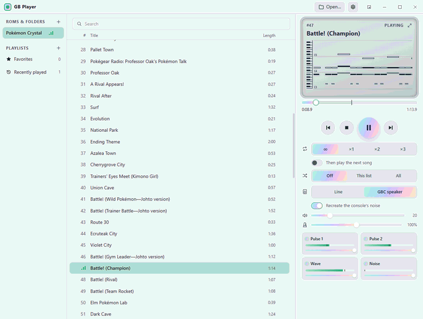
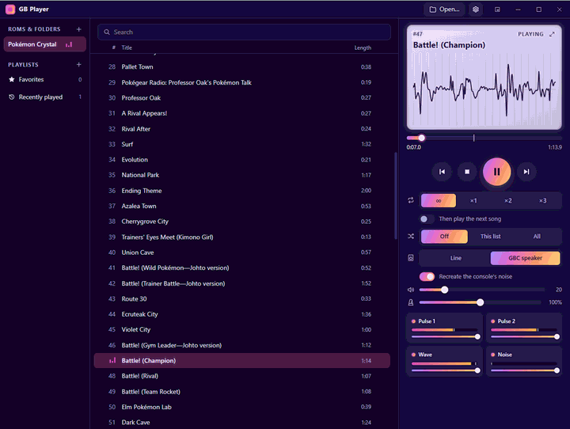
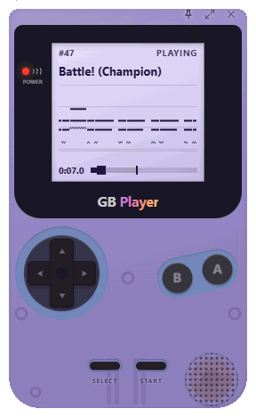
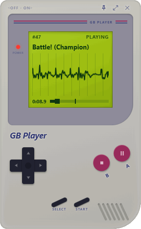

English | [日本語](README.ja.md)


# GB Player

[](https://github.com/SeeLog/gb-player/actions/workflows/rust.yml)
[](https://github.com/SeeLog/gb-player/actions/workflows/frontend.yml)
[](LICENSE)

GB Player plays the music in Game Boy and Game Boy Color ROMs by running each game's own sound engine on a small emulator. Open a ROM, pick a song, and let it loop forever or fade out after a set number of loops.

| Prism theme, piano roll | Nebula theme, waveform |
| --- | --- |
|  |  |

| Mini player, clear purple | Mini player, classic style |
| --- | --- |
|  |  |

- Game Boy-style mini player with buttons that work
- Piano roll and waveform, with a mute and level meter per channel
- Effect that recreates a real GBC's speaker
- Tempo from 50% to 200% at the same pitch
- WAV export, per channel too
- Playlists across ROMs, favourites, history and shuffle
- Editable [themes](themes/README.md), with background images
- Also plays GBS files and audio files (MP3, FLAC and others)

## How it works

GB Player uses no recordings or converted music data. It finds the sound engine in the ROM by its machine code and calls it once per frame, as the game does. The engine runs on an emulated CPU and writes to an emulated sound chip, which makes the waveform as it plays. The game's graphics and logic don't run, only its music.

You can listen to that output directly, or through an effect that recreates a real GBC's speaker and console noise, measured from recordings of the hardware.

## Supported games

| Sound engine | Games |
| --- | --- |
| Generation 1 | Pokémon Red, Blue, Yellow; Japanese Red, Green, Blue, Pikachu |
| Generation 2 | Pokémon Gold, Silver, Crystal |

These are the only games that work out of the box. GB Player finds their engine by its machine code, so other languages and revisions should work too. Any other game needs the addresses of its sound driver routines in a `songs.toml` ([format, in Japanese](songdb/README.md)), and you have to find those yourself. GBS files need none of this, but their songs have no names.

ROMs and GBS files are not included. You need to provide your own.

## Build

There are no prebuilt releases yet. You need [Rust](https://rustup.rs/) and [bun](https://bun.sh/).

```sh
bun install
bun run tauri build --no-bundle   # target/release/gb-player(.exe)
bun run tauri build               # also makes an installer on Windows
bun run tauri dev                 # run for development
```

- **Windows:** use the MSVC toolchain. The GNU one fails with `dlltool.exe: program not found`.
- **Linux:** install `libasound2-dev libwebkit2gtk-4.1-dev libsoup-3.0-dev librsvg2-dev` (Debian/Ubuntu names).
- **macOS:** needs no extra packages.

## Usage

Run `gb-player` and drop a ROM, GBS file or music folder on the window. From the command line:

```sh
gb-player pokemon.gb                         # open a ROM
gb-player --info pokemon.gb                  # list the songs and their loop lengths
gb-player --wav pokemon.gb 1 out.wav 2       # song 1, two loops and a fade, to WAV
gb-player --wav pokemon.gb 1 out.wav 2 gbc-speaker stems   # through the speaker, plus one file per channel
gb-player --lang en pokemon.gb               # choose the language
```

| Key | Action |
| --- | --- |
| Space | Play or pause |
| ← → | Previous or next song |
| Ctrl+O / Ctrl+F | Open a ROM / search |
| Ctrl+M | Switch to the mini player |
| Ctrl+, | Settings |
| F | Fill the window with the piano roll and waveform |

Media keys and headset buttons work while the window is in the background.

Settings, playlists and themes are stored in `%APPDATA%\gb-player` (`~/.config/gb-player` on Linux and macOS).

## Song names

ROMs don't contain song names, so they come from [`songdb/`](songdb/README.md). They are the official titles where a soundtrack lists the song, and describe the place or scene otherwise. Corrections and translations are welcome as pull requests.

## Development

```
crates/gb-core   emulation core (CPU, memory map, MBC, APU)
crates/gb-music  driver detection, song lists, playback, loop analysis
app              Tauri backend, audio output, CLI
ui               React + TypeScript + Tailwind CSS frontend
songdb           song database
```

Run the tests with `cargo test --workspace`. To also check the CPU against [SingleStepTests/sm83](https://github.com/SingleStepTests/sm83), point `SM83_TESTS_DIR` at its `v1/` folder.

## Credits

- [pret](https://github.com/pret)'s disassemblies (pokered, pokeyellow, pokegold, pokecrystal), the basis of the engine detection and the song database
- The [Pokémon Game Sound Library](https://soundlibrary.pokemon.co.jp/) and the HeartGold & SoulSilver soundtrack, for the official song titles
- [SingleStepTests/sm83](https://github.com/SingleStepTests/sm83), for checking the CPU
- [Tauri](https://tauri.app/), [Symphonia](https://github.com/pdeljanov/Symphonia), [cpal](https://github.com/RustAudio/cpal) and [React](https://react.dev/), among other libraries

## License

[MIT](LICENSE).

GB Player is an unofficial project with no ties to Nintendo, The Pokémon Company, GAME FREAK or Creatures, and includes no ROMs or game music. Pokémon and Game Boy are trademarks of their respective owners.
